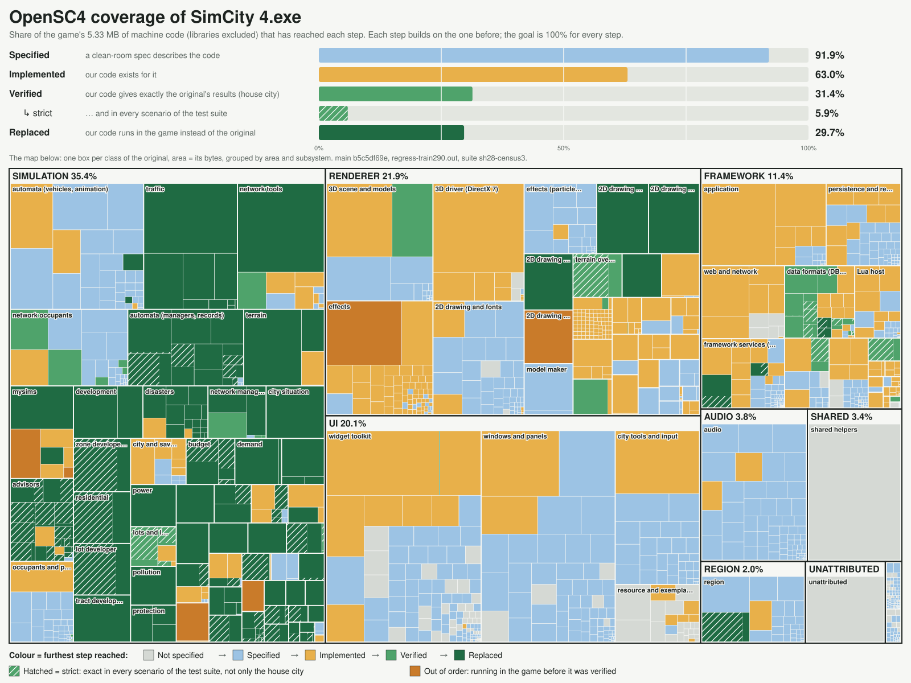

# OpenSC4

**An open-source reimplementation of the SimCity 4 engine, written in Rust.**

SimCity 4 is over twenty years old, still loved, and still running on a 32-bit, mostly single-threaded engine from
2003. OpenSC4 rebuilds its engine from scratch, the way [OpenRCT2](https://openrct2.io/) did for RollerCoaster
Tycoon 2. It replaces the original game piece by piece, proves each piece behaves exactly like the original, and keeps
going until the original executable is no longer needed.

You need your own copy of **SimCity 4 Deluxe** (the GOG 1.1.641 Windows release). OpenSC4 ships no game assets.

> **Status: work in progress, and already playable in a hybrid form.** You can run the real game today with 27 of
> its simulation systems handed over to OpenSC4's Rust code.

## What works today

OpenSC4 runs *inside* the original game as a plugin. Each system can be switched on independently, and the game
keeps running its own code for everything else.

- **The clock, budget, demand, ordinances and weather.**
- **Every map-based system:** power, water, pollution, crime, fire and police coverage, land value,
  flammability, trees and landfills.
- **Growth:** residential, commercial and industrial simulation, building development, the lot and zone developers,
  zoning, tract development, civic buildings, parks and neighbour cities.
- **Traffic:** the traffic simulator and the pathfinder.

Cores for the disaster layer, terrain, automata, the network and occupant managers, props and lot configurations,
ports and the city detail manager are written and tested, and are being wired into the game. The terrain already runs
next to the original and matches it exactly.

### "Exactly like the original" is measured

Each replacement comes with a *shadow*: our code runs next to the original on the same live city, at the same moment,
and every result is compared, down to the bit. In the test cities, budgets match on every month-end, demand matches
on every day, and the map-based systems match the original **cell by cell, for decades of game time**. With all ten
map-based replacements on at once, a test city followed the same funds curve as the unmodified game for 36 game years.

## Where it's going

- **Mod compatibility.** The SimCity 4 community has two decades of buildings, lots, networks and tuning mods.
  OpenSC4 reads the game's own data formats, so existing content keeps working, with the most important mods ported
  if a mod ever relies on something that cannot be carried over.
- **Play in the browser.** The core is portable Rust with no platform code, and it already compiles to WebAssembly
  unchanged.
- **Much bigger cities.** The original engine slows to a crawl long before a city gets large. The goal is the first
  **100-million-population city running smoothly**.
- **No original executable.** Rendering, UI, audio and the region view, so OpenSC4 starts on its own.

The aim is a faithful engine first. New gameplay ideas will live in clearly separate extensions, so the base game
stays the game people know.

## Progress

Progress is measured, not estimated. [`tools/coverage.py`](tools/coverage.py) assigns every function of the original
executable to the class that owns it and adds up the bytes of machine code at each stage. Library and compiler code
is left out.

The full breakdown is in [docs/coverage-report.md](docs/coverage-report.md) and the rules are in
[docs/COVERAGE.md](docs/COVERAGE.md). `python tools/coverage.py` and `python tools/coverage_treemap.py` regenerate
both from the RE workspace.

| Milestone | State |
|---|---|
| M0: toolchain and in-game plugin | ✅ Done |
| M1: the clock | ✅ Done |
| M2: budget, demand, ordinances, weather | ✅ Done, verified identical |
| M3: map-based systems | ✅ Done, verified identical cell by cell |
| M4: growth | 🟡 Running in game and verified, including commercial, industrial, lots and zones; the final growth check to go |
| M5: traffic | 🟡 Running in game; matches the original on about two thirds of month lines, calibration to go |
| M6+: rendering, UI, audio, region, standalone | ⬜ Data, save, texture and 3D model readers done; specs for the renderer and UI are next |

Measured progress is [docs/coverage-report.md](docs/coverage-report.md). The repository's maintained tools and documents are listed in [docs/ops/inventory.md](docs/ops/inventory.md). The
milestones are defined in [docs/ARCHITECTURE.md](docs/ARCHITECTURE.md#roadmap).

## Try it

There are no prebuilt releases yet. To run the hybrid game today:

1. Build `FreeCity4.dll` (the project's former name; the file names have not changed yet) as described in
   [engine/README.md](engine/README.md#build-and-test). You need Rust and the Visual Studio 2022 Build Tools.
2. Copy it into your `Documents\SimCity 4\Plugins\` folder.
3. Choose which systems to hand over in a `FreeCity4.ini` next to the DLL, for example
   `enable = power, pollution, crime, traffic`. The full list of keys is in
   [engine/README.md](engine/README.md#installing-and-checking-in-game).

The clock and the budget are replaced by default; everything else stays the original until you enable it.

## How it's built

- **Clean room.** The original game is studied to write behaviour specifications; the engine is written from those
  specifications only. Nobody, human or AI agent, works on both sides for the same subsystem. The rules are in
  [CONTRIBUTING.md](CONTRIBUTING.md).
- **Specs:** [docs/specs/](docs/specs/), one per subsystem, with conformance tests.
- **Engine:** a portable Rust core ([engine/core](engine/core)), the data formats ([engine/formats](engine/formats))
  and a thin C++ plugin that plugs the core into the running game ([engine/plugin](engine/plugin)).
- **Verification:** about 900 conformance test vectors, plus the in-game shadow comparisons above.

## Contributing

Contributions are welcome. Read [CONTRIBUTING.md](CONTRIBUTING.md) first, because the clean-room rules decide what
each role may open.

- **Coordinator:** [docs/HANDOFF.md](docs/HANDOFF.md) (one page: the current state and an index of
  [docs/ops/](docs/ops/)). Every lane reads it first.
- **Implementer (engine code):** [CONTRIBUTING.md](CONTRIBUTING.md), then [docs/specs/](docs/specs/) (questions for the
  RE side go in [docs/specs/QUESTIONS.md](docs/specs/QUESTIONS.md)), [docs/abi/](docs/abi/) and
  [engine/README.md](engine/README.md). The reverse-engineering workspace is not for implementers.
- **Spec writer (RE side):** [docs/specs/foundations.md](docs/specs/foundations.md), [re/](re/) and the
  [reverse-engineering workspace](docs/re-workspace.md) (early RE notes, data, tooling, rebuilding it locally).

## License

GPL-3.0-or-later; see [LICENSE](LICENSE). SimCity 4 is a trademark of Electronic Arts. OpenSC4 is not affiliated with
or endorsed by Electronic Arts or Maxis, and it contains no original game code or assets.
